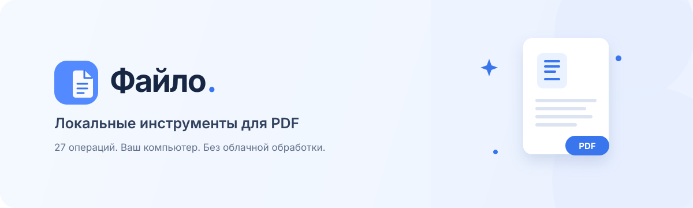

<div align="center">
  
  <p><strong>27 инструментов для PDF, изображений и документов — прямо на вашем компьютере.</strong></p>
  <p>
    <a href="#возможности">Возможности</a> ·
    <a href="#запуск">Запуск</a> ·
    <a href="#приватность">Приватность</a> ·
    <a href="#ограничения">Ограничения</a>
  </p>
</div>

**Файло** — локальное веб-приложение для повседневной работы с документами. Оно запускает небольшой сервер только на `127.0.0.1`, а файлы обрабатывает локальными библиотеками и программами. Сводка и перевод используют модель Ollama на этом же компьютере.

## Возможности

| Задача | Инструменты |
| --- | --- |
| Страницы и изображения | Объединить и разделить PDF, изменить порядок страниц, повернуть, обрезать, преобразовать PDF в JPG/PNG и собрать изображения в PDF |
| Оформление PDF | Сжать документ, добавить водяной знак или номера страниц, поставить нарисованную подпись |
| Текст и распознавание | OCR на русском и английском, экспорт текста в DOCX, XLSX, Markdown, создание PPTX из страниц PDF |
| Конвертация и формы | Office и HTML в PDF, заполнение интерактивных PDF-форм |
| Другие операции | Сравнить документы, восстановить PDF, защитить паролем или снять пароль, создать PDF/A, скрыть область страницы с растрированием |
| Локальный AI | Составить краткую сводку или перевести извлечённый из PDF текст через Ollama |

## Запуск

### Требования

- macOS
- Node.js 22 или новее
- Homebrew
- Для OCR, офисных форматов и других системных операций — дополнительные программы из списка ниже
- Для AI — Ollama и примерно 5 ГБ места под модель `qwen2.5:7b`

### Установка

```sh
brew install ocrmypdf tesseract-lang poppler ghostscript qpdf libreoffice ollama
npm ci
```

Запустите сервер:

```sh
npm start
```

Откройте [http://127.0.0.1:4173](http://127.0.0.1:4173). Не открывайте `index.html` напрямую через `file://`: странице нужен локальный сервер.

При первом запуске AI-модели загрузите её в отдельном терминале:

```sh
ollama pull qwen2.5:7b
```

Если служба Ollama ещё не запущена, запустите её командой `ollama serve`. Для распознавания русского текста убедитесь, что Tesseract видит языки `rus` и `eng`. Состояние установленных инструментов и AI можно проверить на [http://127.0.0.1:4173/api/health](http://127.0.0.1:4173/api/health).

## Проверка

```sh
npm run check
npm test
```

Интеграционные тесты запускают локальный сервер и проверяют преобразование документов, PDF/A, OCR, формы и другие операции. Для них нужны системные утилиты, перечисленные выше.

## Приватность

- Сервер по умолчанию слушает только `127.0.0.1`, а не сеть.
- Загруженные файлы обрабатываются на этом компьютере, временно хранятся в системном каталоге и удаляются после ответа.
- Максимальный размер одного файла — 50 МБ.
- AI-запросы отправляются в локальный Ollama; облачный API не используется.
- Не меняйте `HOST` на публичный адрес и не выставляйте сервер в интернет: в приложении нет аккаунтов и сетевой авторизации.

## Ограничения

- Экспорт PDF в DOCX и XLSX извлекает текст и не сохраняет исходную вёрстку. PPTX создаётся из изображений страниц.
- Сводка и перевод сохраняются как обычный текст. AI может ошибаться — проверяйте результат, особенно даты, числа и имена.
- Сканированный документ сначала нужно обработать OCR, чтобы получить текст для сводки или перевода.
- Подпись добавляется в виде изображения и не является криптографической или юридически подтверждённой электронной подписью.
- Скрытая область PDF растрирует страницы результата: текст на них нельзя выделить, но качество изображения может снизиться.
- Результат ремонта PDF и преобразования в PDF/A зависит от исходного документа и установленной версии Ghostscript.

## Настройки

| Переменная | По умолчанию | Назначение |
| --- | --- | --- |
| `PORT` | `4173` | Порт локального веб-сервера |
| `HOST` | `127.0.0.1` | Адрес прослушивания; оставляйте локальным |
| `OLLAMA_MODEL` | `qwen2.5:7b` | Имя установленной модели Ollama |
| `PDFA_ICC_PROFILE` | Автопоиск Homebrew | Путь к ICC-профилю для PDF/A |

## Лицензия

Лицензия пока не добавлена. Публичная доступность репозитория сама по себе не предоставляет разрешение повторно использовать или распространять код.
